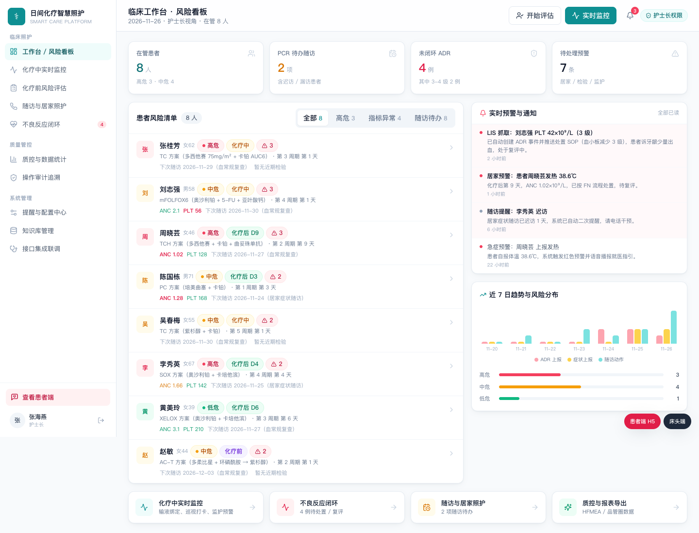
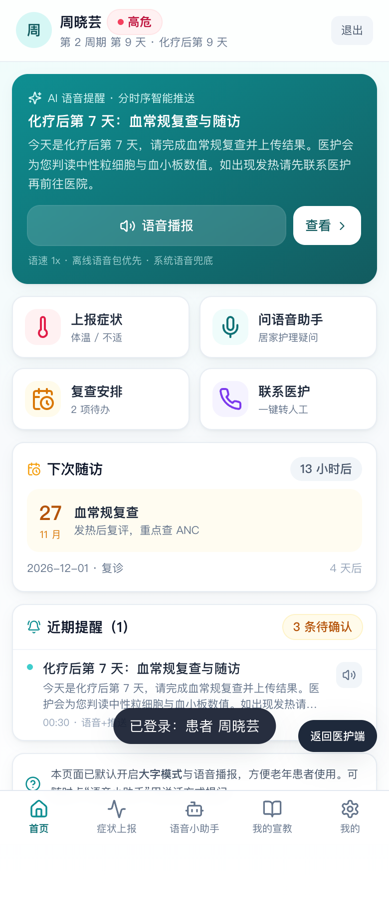
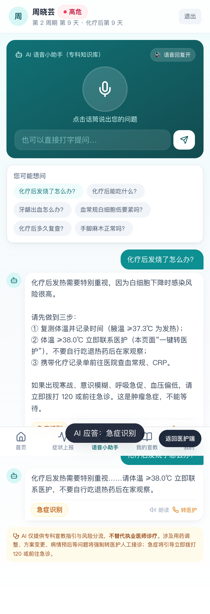
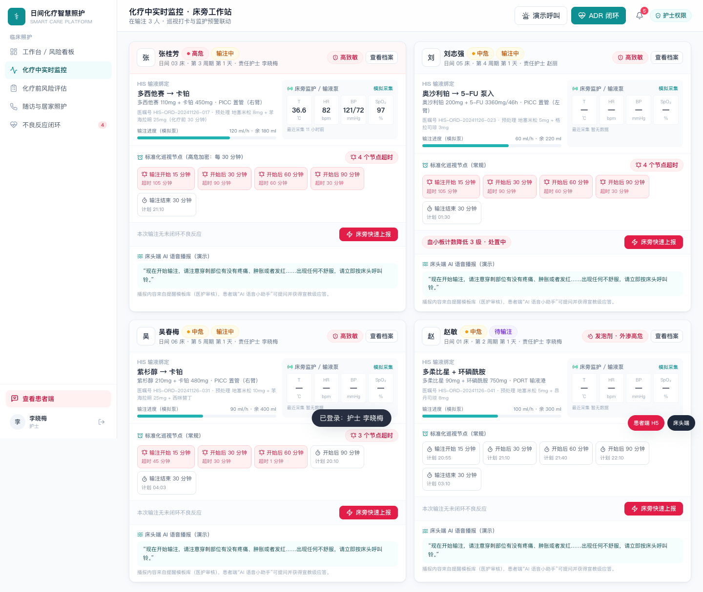
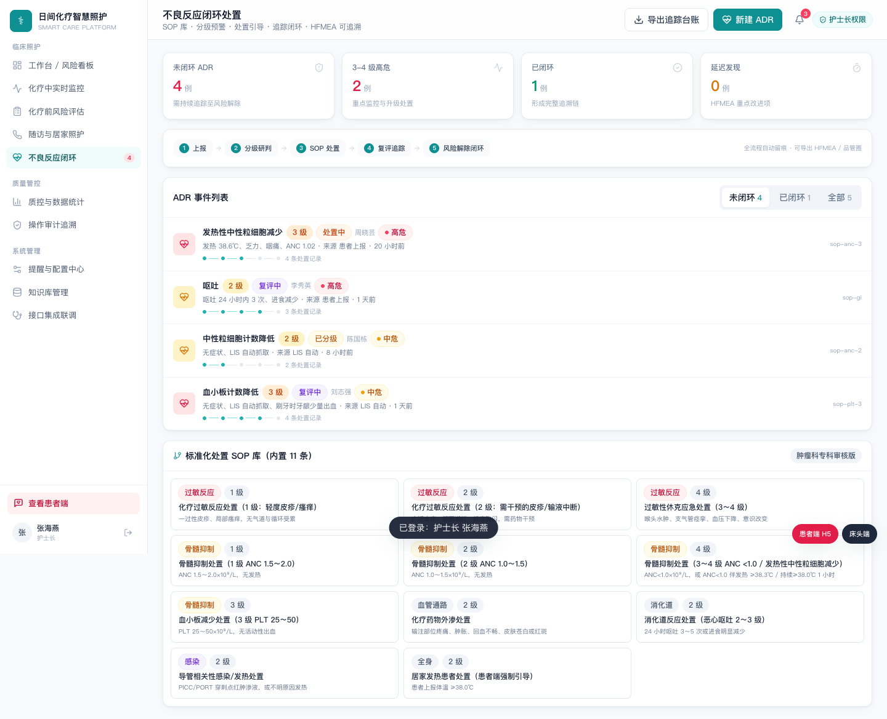
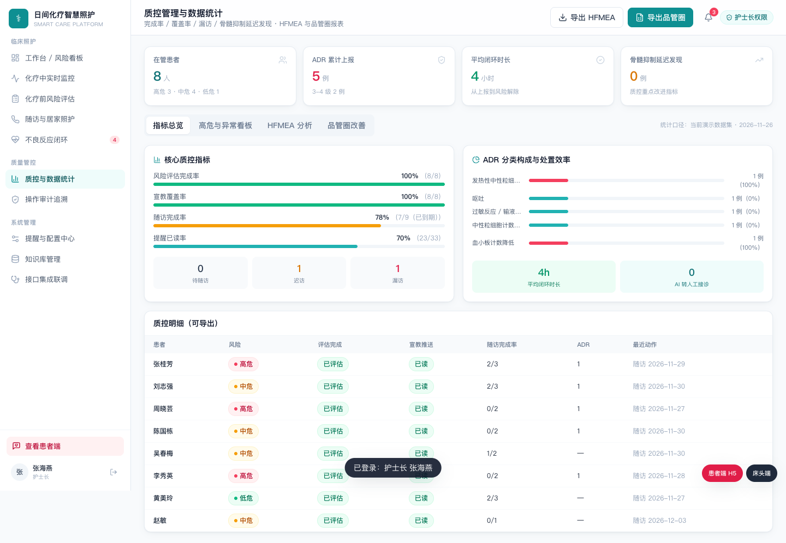

# 日间化疗患者智慧照护系统

> 覆盖 **化疗前风险评估 → 化疗中实时监控 → 化疗后居家随访** 全周期的智慧照护平台，融合 AI 语音交互、分层智能提醒、骨髓抑制/过敏风险预警与不良反应（ADR）闭环处置，支撑 HFMEA / 品管圈风险管控落地。

**在线体验** → https://greatday4yole.github.io/daychemo-smart-care/
｜ 患者端直达 `#/patient` ｜ 床头端直达 `#/bedside`（均免登录）

<table>
<tr>
<td align="center"><br/><b>医护端</b><br/><sub>选角色进入</sub></td>
<td align="center"><br/><b>患者端 H5</b><br/><sub>手机扫码体验</sub></td>
<td align="center"><br/><b>床头端</b><br/><sub>病房大屏</sub></td>
</tr>
</table>



[](https://github.com/greatday4yole/daychemo-smart-care/actions/workflows/deploy.yml)


> ⚠️ 本仓库为**需求方案演示环境**，全部为虚构数据，不含任何真实患者信息。AI 仅提供宣教指引与风险分流，**不替代执业医师诊疗**。院内生产部署须完成等保三级与医疗数据合规改造（见[运维文档](docs/运维文档.md)）。

---

## 一、三端一览

| 端 | 适用 | 关键能力 | 入口 |
|---|---|---|---|
| **医护 Web 端** | 医生 / 护士 / 护士长 / 质控员 / 管理员 | 风险评估、巡视打卡、床旁上报、ADR 闭环、随访干预、质控报表、配置中心 | 首页选角色 |
| **患者端 H5** | 患者 / 家属（手机） | 分时序语音提醒、症状上报（CTCAE 初判）、AI 语音问答、宣教、随访打卡 | `#/patient` |
| **床头端** | 病房平板 / 床头屏 | 大字输注信息、实时监护、语音播报、语音提问、一键呼叫 | `#/bedside` |

<table>
<tr>
<td align="center"><br/><sub>患者端首页：AI 语音提醒 + 复查安排 + 近期提醒</sub></td>
<td align="center"><br/><sub>AI 语音问答：知识库命中 + 急症识别 + 转医护</sub></td>
<td align="center"><br/><sub>化疗中实时监控：输液绑定 / 巡视打卡 / 监护预警</sub></td>
</tr>
</table>

---

## 二、核心功能

### 模块 1 · 化疗前风险评估（医护端）
- **14 项 / 5 维度**标准化评估表单（过敏史、既往骨髓抑制、基础疾病、血管条件、营养支持），一键勾选。
- 加权归一化自动计分，**低危 0–29 / 中危 30–59 / 高危 ≥60** 三档。
- **分级联动**：高危 → 红色置顶 + 每 30 分钟巡视 + 5 次加密复查 + 24h 随访。
- HIS 药物属性自动带入（高致敏、发泡剂）；内嵌 **CTCAE v5.0** 知识库可即时查阅。
- 提交后自动生成随访计划与**个体化宣教清单**并推送患者端，评估自动归档同步护理记录。

### 模块 2 · 化疗中实时监控（医护端 + 床头端）
- 输液绑定 HIS 医嘱/药物属性，自动标识**发泡剂·外渗高危**、**高致敏 ≥3 级**。
- 标准化巡视节点（15/30/60/90 分钟 + 结束），超时标红并计超时分钟数。
- 床旁 6 项快捷上报（皮疹/胸闷/心慌/外渗/恶心/发热），**自动带出处置 SOP**。
- 监护/输液泵阈值预警（T ≥38.0 / HR >110 / SBP <90 / SpO₂ <94）→ 弹窗 + 站内推送。
- 床头端 AI 语音播报输注注意事项，支持语音提问即时应答。

### 模块 3 · 化疗后随访与居家照护
- **13 条分时序提醒模板**（化疗前 24h → 化疗中 → 化疗后 6h/24h/72h/120h/168h/336h/504h），按风险分层过滤。
- 居家**症状自助上报**：10 个症状图标 + 体温 + **语音快速录入**，自动 CTCAE 初判；发热 ≥38.3℃、出血、胸闷气促等高危症状**立即红色预警 + 语音引导就医**。
- **随访闭环台账**：待随访 / 已完成 / **迟访** / **漏访**，漏访自动二次提醒（推送 + 语音 + 短信）。
- 宣教素材库（图文 / 语音 / 图文+语音）按化疗阶段与风险等级精准推送。

### 模块 4 · AI 语音提醒引擎
- 普通话 TTS，语速 0.8 / 1.0 / 1.2 三档可调；**11 段离线语音包**（`say` + `ffmpeg` 预生成 MP3），弱网/离线可播，失败自动回落系统 TTS。
- 语音识别（STT）实时转写，支持全程"说话"完成症状上报与提问；不支持时自动降级文字输入。
- **三级应答边界**：`education` 自动应答 ｜ `triage` 强制转人工 ｜ `emergency` 强制引导 120/急诊。
- **免打扰时段**（默认 22:00–07:00，支持跨零点）语音静默、文字照常。
- 模板由医护后台可视化配置，内容须**专科审核**后方可生效。

### 模块 5 · 不良反应闭环处置
- **11 条 SOP 库**：过敏 1/2/3 级与过敏性休克、ANC 1/2/3–4 级（含 FN）、PLT 3 级、化疗外渗、消化道反应、导管感染、居家发热。
- LIS 血常规自动抓取 → **CTCAE 阈值研判** → ≥2 级自动建 ADR 并推送责任护士；≥3 级标红。
- 五态闭环：`reported → triaged → handling → rechecking → closed`，全程时间线留痕。
- 记录"延迟发现"标记，导出 ADR 台账供 HFMEA / 品管圈分析。



### 模块 6 · 质控管理与数据统计
- 六项指标自动统计：风险评估完成率、宣教覆盖率、随访完成率、ADR 数量、**骨髓抑制延迟发现例数**、平均闭环时长。
- 三栏风险看板：高危患者 / 指标异常 / 迟访漏访。
- 报表导出：**HFMEA（S/O/D/RPN）**、品管圈改善数据、质控明细、审计日志（CSV / JSON）。
- 六角色权限矩阵（RBAC），患者仅可见本人数据。



---

## 三、快速开始

```bash
git clone https://github.com/greatday4yole/daychemo-smart-care.git
cd daychemo-smart-care
npm ci
npm run dev             # 本地开发 http://localhost:5173
npm run build           # 构建 dist/
npm run preview         # 预览构建产物 http://localhost:4173
```

### 演示账号（免密码，首页一键进入）
| 角色 | 姓名 | 演示重点 |
|---|---|---|
| 护士 | 李晓梅 | 评估、巡视打卡、床旁上报、随访干预 |
| 医生 | 王建国 | ADR 处置与复评、质控查看 |
| 护士长 | 张海燕 | 模板/宣教配置、报表导出、审计 |
| 质控员 | 陈静 | HFMEA / 品管圈导出（只读） |
| 管理员 | 系统管理员 | 接口联调、知识库、权限 |
| 患者 | 周晓芸 | 语音提醒、症状上报、AI 问答、宣教 |

### 推荐演示路径
1. **护士**：工作台 → 化疗前评估（勾选看分值变化）→ 提交（自动生成随访）→ 实时监控（模拟采集触发弹窗）→ 床旁上报。
2. **医生**：ADR 闭环 → 打开事件查看自动匹配的 SOP → 提交复评 → 闭环。
3. **护士长/质控**：质控页查看完成率 → HFMEA RPN → 导出 CSV。
4. **患者**：`#/patient` → 听语音提醒 → 上报发热 38.8℃（触发高危引导）→ 语音提问 → 转人工。
5. **床头端**：`#/bedside` → 输注信息 + 实时监护 + 语音播报 + 语音提问。

---

## 四、可选：带持久化的后端

内置零依赖演示后端（Node 内置 `http` + `node:sqlite`），实现与前端一致的 REST 契约、CTCAE 自动研判与审计留痕：

```bash
npm run build
node server/index.mjs            # 默认 http://127.0.0.1:8787，同时托管 dist/
curl -s http://127.0.0.1:8787/api/health
curl -s -X POST http://127.0.0.1:8787/api/v1/integrations/lis/results \
  -H 'content-type: application/json' \
  -d '{"patientId":"p3","wbc":1.9,"anc":0.86,"plt":52,"hb":96,"orderId":"LIS-TEST"}'
```

14 个接口清单见 [PRD §4](docs/PRD.md#四接口集成需求)，或 `GET /api`。

---

## 五、验证

```bash
npm run verify     # 业务规则自检：CTCAE 阈值、评分分级、随访计划、AI 边界、免打扰、
                   # SOP/宣教/模板覆盖度、权限矩阵、脱敏、接口契约、文档齐备（28 项）
npm run smoke      # 端到端冒烟（Playwright + Chrome）：24 项，遍历全部页面与关键业务动作
```

`smoke` 需先启动预览服务（`npm run preview`）并本地安装 Playwright 浏览器：
`npm i -D playwright && npx playwright install chromium`。
截图输出到 `/tmp/daychemo-shots`（可用 `SHOT_DIR` 覆盖）。

---

## 六、技术栈与工程结构

```
├── src/
│   ├── types.ts                 # 领域模型（Patient/ADR/Reminder/SOP/KB…）
│   ├── data/                    # 临床知识资产（可配置，院内可校准）
│   │   ├── riskForm.ts          # 14 项评估表单 + 权重 + 分级阈值 + 联动动作
│   │   ├── ctcae.ts             # CTCAE v5.0 分级库（15 条）
│   │   ├── sop.ts               # 处置 SOP 库（11 条）
│   │   ├── templates.ts         # AI 语音提醒模板（13 条）
│   │   ├── education.ts         # 宣教素材库（10 条）
│   │   ├── kb.ts                # AI 问答知识库（15 条，三级边界）
│   │   └── seed.ts              # 演示数据（8 位虚构患者 + 全流程事件）
│   ├── lib/                     # 业务规则引擎
│   │   ├── ctcae.ts             # 阈值分级 / 高危症状 / 分诊
│   │   ├── qc.ts                # 质控指标 / HFMEA / 品管圈 / CSV 导出
│   │   ├── permissions.ts       # RBAC 权限矩阵
│   │   └── date.ts              # 日期 / 免打扰 / 脱敏
│   ├── store/app.ts             # 状态与全部业务动作（评估/ADR/随访/问答/接口注入）
│   ├── voice/engine.ts          # TTS / STT / 离线语音包
│   ├── pages/
│   │   ├── nurse/               # 工作台、实时监控、评估、随访、ADR
│   │   ├── qc/                  # 质控、审计
│   │   ├── admin/               # 配置中心、知识库、接口联调
│   │   └── patient/             # 患者端 H5、床头端
│   └── components/              # UI 基础组件、应用框架、患者档案抽屉
├── public/audio/                # 离线语音包（11 段 MP3 + manifest）
├── server/index.mjs             # 演示后端（SQLite + REST，零依赖）
├── tools/
│   ├── verify.mjs               # 业务规则校验
│   ├── smoke.mjs                # 端到端冒烟（Playwright）
│   ├── gen-audio.mjs            # 离线语音包生成
│   └── gen-ppt.py               # 培训 PPT 生成
├── webapp-miniprogram/          # 微信小程序壳工程（web-view）
└── docs/                        # PRD、操作手册、运维文档、知识库模板、培训 PPT
```

---

## 七、交付文档

| 文档 | 说明 |
|---|---|
| [需求规格说明书（PRD）](docs/PRD.md) | 在原需求上补全业务规则、字段口径、状态机、接口契约、**29 条验收标准**与实现位置 |
| [操作手册](docs/操作手册.md) | 分角色逐步操作指引 + FAQ + 2 小时培训安排 |
| [运维文档](docs/运维文档.md) | 架构、环境要求、三种部署方式、配置项、备份、故障排查、安全合规、扩展路线 |
| [知识库导入模板](docs/知识库导入模板.md) | 五类知识资产（KB/SOP/CTCAE/宣教/模板）+ HFMEA 条目 的字段定义、CSV/JSON 模板、10 项验收清单 |
| [培训 PPT](docs/日间化疗智慧照护系统-培训PPT.pptx) ｜ [大纲与讲稿](docs/培训PPT.md) | 17 页 16:9，含两条演示路径、考核任务与持续改进机制 |

---

## 八、关键设计取舍

| 取舍 | 原因 |
|---|---|
| **AI 采用检索式知识库，不接生成式大模型** | 原需求明确"AI 不可随意生成诊疗方案"。检索式 + 规则边界可完全可控、可审计、无幻觉风险 |
| **风险评分权重显式可配** | 原需求只要求"自动分级"未定义算法；权重与阈值集中在 `riskForm.ts`，院内可用真实数据校准 |
| **患者端用响应式 H5 + 小程序壳** | 原生小程序须企业 AppID + 备案 + 医疗类目资质（1–3 周）；H5 已覆盖全部交互，壳工程可在资质齐备后 1 天上线 |
| **演示版纯前端（localStorage）** | 演示与培训不需要账号体系与真实数据；同一套业务规则另有 SQLite 后端实现，可切换为服务端持久化 |
| **语音 TTS 优先系统合成 + 离线 MP3 兜底** | 院内网络常限制外网，系统 TTS 本地可用；离线包覆盖核心播报，断网仍可用 |
| **ADR 五态机而非二元开关** | 真实临床中"上报"不等于"处理完"，必须走到"风险解除"才能闭环，HFMEA 需要中间过程数据 |

---

## 九、许可

MIT License · 临床内容（SOP / 宣教 / 知识库）参考 CSCO、NCCN、CTCAE v5.0 等公开指南整理，**仅供演示，不得直接用于临床决策**。
