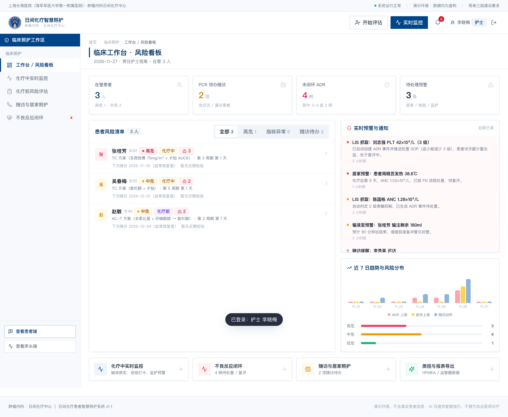
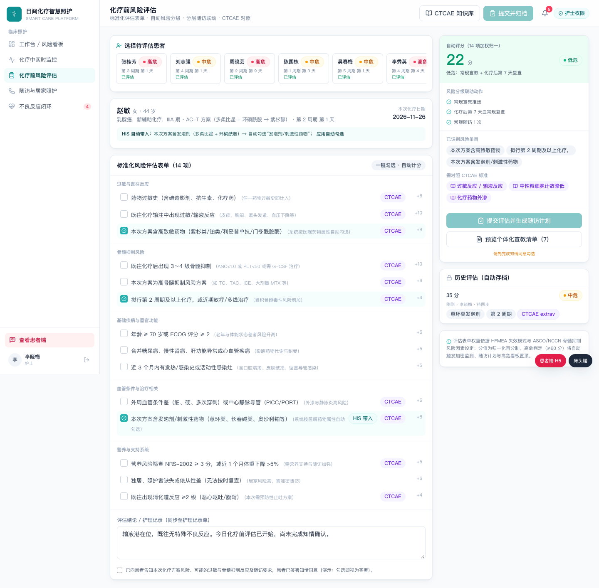
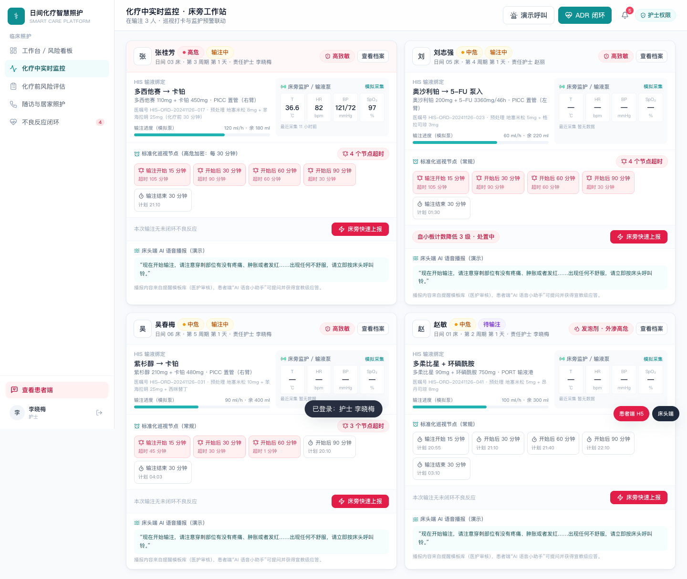
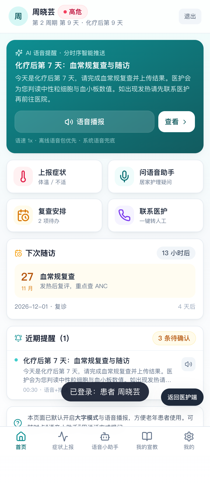
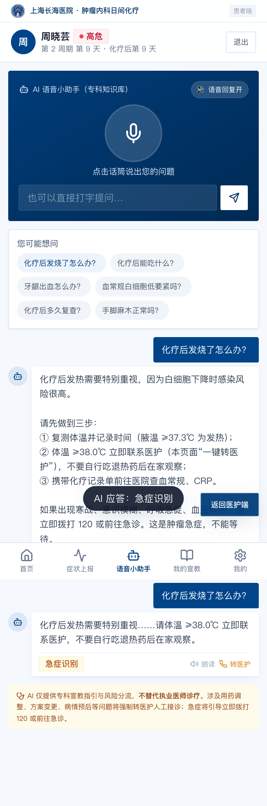

# 日间化疗智慧照护系统 · 操作手册

> 版本 v1.1 ｜ 适用对象：医生、护士、护士长、质控员、患者及家属、系统管理员

## 扫码进入演示

<table>
<tr>
<td align="center"> <b>医护端</b></td>
<td align="center"> <b>患者端 H5</b></td>
<td align="center"> <b>床头端</b></td>
</tr>
</table>

---

## 0. 快速开始（3 分钟走通全流程）

演示地址：**https://greatday4yole.github.io/daychemo-smart-care/**

1. 打开首页 → 选择「**李晓梅 · 责任护士**」进入。
2. 左侧点「**化疗前风险评估**」→ 选择「赵敏」→ 勾选任意 3 项 → 观察右上角分值实时上升 → 勾选知情同意 → 点「**提交评估并生成随访计划**」。
3. 左侧点「**随访与居家照护**」→ 看到新增的随访任务（按风险分层生成）。
4. 左侧点「**化疗中实时监控**」→ 在张桂芳卡片上点「**模拟采集**」→ 看到体征异常弹窗。
5. 点卡片上「**床旁快速上报**」→ 勾选「皮疹/瘙痒」+ 2 级 → 提交 → 看「**不良反应闭环**」中新增事件与自动匹配的 SOP。
6. 右上角浮动的「**患者端 H5**」→ 进入患者端：语音播报提醒 → 症状上报 → AI 语音提问 → 宣教。
7. 返回登录页，选「**张海燕 · 护士长**」→ 「**质控与数据统计**」→ 导出 HFMEA CSV。

> 提示：所有数据保存在浏览器本地，可反复演练；在「提醒与配置中心 → 演示数据管理」可一键恢复初始数据。

---

## 1. 登录与角色切换

1. 打开系统首页，可见 6 个演示角色卡片，每张卡标注该角色核心能力。
2. 点击卡片即进入对应端，**无需密码**（演示环境）。
3. 切换角色：侧栏底部头像旁的「退出」图标 → 回到首页重新选择。
4. 真实环境将对接院内统一身份认证（OAuth2 / CAS），并按角色渲染菜单。

| 角色 | 进入后看到的菜单 |
|---|---|
| 医生 | 工作台、实时监控、随访、ADR、质控、审计、知识库 |
| 护士 | 工作台、实时监控、化疗前评估、随访、ADR |
| 护士长 | 以上全部 + 配置中心、知识库管理、接口联调、审计 |
| 质控员 | 工作台、随访、ADR（只读）、质控、审计、知识库（只读） |
| 管理员 | 质控、配置中心、知识库、接口联调、审计 |
| 患者 | 患者端 H5（语音提醒 / 症状上报 / AI 助手 / 宣教 / 我的） |

---

## 2. 护士操作：化疗前风险评估

### 2.1 入口与选人
1. 左侧菜单「**化疗前风险评估**」。
2. 顶部横向滑动选择患者；已评估患者卡右下角显示「已评估」。

### 2.2 填写表单
1. 系统检测到 HIS 信息（高致敏药物、发泡剂、年龄 ≥70）时，顶部出现蓝色提示条「HIS 自动带入」，点「**应用自动勾选**」可一键勾选对应条目。
2. 逐项点击条目或勾选框，右侧分值实时更新。
3. 每条目右侧的紫色 `CTCAE` 徽标可点击查阅分级对照标准（弹窗内可切换其他条目）。
4. 右栏实时显示：分值、风险等级（低/中/高）、联动动作清单、已识别风险条目。

### 2.3 提交
1. 在「评估结论 / 护理记录」填写既往过敏的具体表现、处理经过、本次预处理方案（会同步护理记录）。
2. 勾选「已向患者告知…知情同意」。
3. 点「**提交评估并生成随访计划**」。
4. 弹窗显示结果：分值、等级、已生成的随访计划（低危 1 条 / 中危 3 条 / 高危 5 条）、宣教清单已推送。
5. 可点「**查看随访计划**」跳到随访页，或「**查看宣教清单**」预览推送内容。

> 注意：未勾选知情同意时提交按钮为禁用状态。

### 2.4 历史评估
右栏「历史评估」列出该患者全部评估（时间、分值、等级、标签、CTCAE 关联、同步状态），点击可回顾。

---

## 3. 护士操作：化疗中实时监控

### 3.1 患者卡片信息
每张卡片展示：患者/床位/周期/责任护士、风险徽标、药物属性徽标（发泡剂 / 高致敏）、HIS 医嘱号、预处理方案、输注进度条。

### 3.2 巡视打卡
1. 「标准化巡视节点」区域显示 5 个节点及计划时间。
2. 超时节点变红并显示「超时 N 分钟」，卡片标题右侧出现「N 个节点超时」提示。
3. 到床旁观察后点击对应节点按钮 → 变绿并记录打卡时间。
4. 高危患者节点密度高于常规（每 30 分钟）。

### 3.3 模拟监护采集
1. 右上「模拟采集」按钮触发一次生命体征上报（随机正常/异常）。
2. 异常时弹出红色弹窗，提示具体数值与处置建议（SBAR 报告医生）。
3. 正常时数据刷新到四个体征格（T / HR / BP / SpO₂）。

### 3.4 床旁快速上报
1. 点卡片底部「**床旁快速上报**」。
2. 勾选观察到的症状（皮疹/瘙痒、胸闷/气促、心慌、穿刺点肿胀、恶心呕吐、发热，可多选）。
3. 填体温、选择初步分级（1/2/3 级）、补充描述（如"输注 20 分钟出现颜面潮红、胸闷，HR 102，SpO₂ 96%"）。
4. 提交后：自动匹配 SOP、创建 ADR 事件、推送站内通知；在「不良反应闭环」中可继续推进。

### 3.5 床头端语音
卡片底部「床头端 AI 语音播报」展示当前播报文案（来源：提醒模板库）。点击右下角浮动「**床头端**」可切到大屏床头端视图。

---

## 4. 医护操作：不良反应闭环

### 4.1 查看事件
1. 左侧「**不良反应闭环**」。
2. 顶部四个指标：未闭环、3-4 级高危、已闭环、延迟发现。
3. 列表每条显示：反应类型、分级徽标、状态、来源（患者上报 / LIS 自动 / 设备 / 护士）、患者、处置记录条数、五步进度点。

### 4.2 处置推进
1. 点任意事件打开「**ADR 处置追踪**」。
2. 弹窗内依次展示：CTCAE 分级对照 → 自动推送的 SOP（处置步骤 / 医嘱参考 / 复查要求 / 升级条件 / 依据）→ 处置追踪时间线。
3. 底部按钮随状态变化：
   - 「已上报」→「确认分级并开始处置」
   - 「已分级/处置中」→「处置完成，提交复评」或「风险解除 · 闭环」
   - 「复评中」→「风险解除 · 闭环」
4. 每次操作都会在时间线追加一条记录（时间 / 操作人 / 角色 / 动作 / 详细描述），闭环后写入闭环时间。

### 4.3 手工新建 ADR
右上「新建 ADR」→ 选患者、反应类型（CTCAE 15 条）、分级 → 创建并推送 SOP。

### 4.4 导出
右上「导出追踪台账」→ CSV，字段含患者、反应、分级、来源、状态、SOP、上报时间、闭环时间、是否延迟发现。

### 4.5 SOP 库
页面下方「标准化处置 SOP 库」列出 13 条，点击查看完整步骤、医嘱、复查、升级条件与依据出处。

---

## 5. 医护操作：随访与居家照护

### 5.1 台账筛选
顶部 Tab：全部 / 待随访 / 迟访 / 漏访 / 已完成。迟访行淡黄底、漏访行淡红底，并显示超期天数。

### 5.2 二次提醒
1. 单条：行右侧「**二次提醒**」→ 发送推送 + 语音 + 短信（记录 attempts +1，状态待随访→迟访）。
2. 批量：页头「**批量二次提醒**」→ 对所有迟访/漏访一键提醒。

### 5.3 填写随访记录
1. 点「**填写随访**」→ 弹窗显示患者与任务信息。
2. 输入记录，例如："电话回访已接通，体温 36.7℃，无发热无出血，复查血常规 ANC 2.1，嘱第 14 天再复查。"
3. 「**保存并完成**」→ 状态置为已完成，写入处理人与时间；「**标记迟访**」→ 记录未联系原因。

### 5.4 AI 转人工接诊队列
右下方展示患者提问、AI 应答摘要、是否患者主动转人工；可「查看患者」或「电话回访」。

### 5.5 居家症状上报记录
展示患者上报的症状、体温、分级、是否高危预警、是否已关联 ADR。

---

## 6. 质控员 / 护士长：质控与数据统计

1. 左侧「**质控与数据统计**」。
2. 顶部四指标：在管患者、ADR 累计、平均闭环时长、骨髓抑制延迟发现。
3. Tab「指标总览」：四项完成率进度条（评估完成率、宣教覆盖率、随访完成率（**分母为已到期任务**）、提醒已读率）+ 待随访/迟访/漏访 + ADR 分类构成 + 质控明细表（逐患者可核）。
4. Tab「高危与异常看板」：高危患者、指标异常患者、迟访/漏访患者三栏并排。
5. Tab「HFMEA 分析」：表格含失效模式、失效原因、影响、当前措施、S、O、D、RPN；RPN ≥200 红底、100–199 黄底。
6. Tab「品管圈改善」：按不良反应类型统计发生例数与 3-4 级占比，并给出改善建议。
7. 导出：页头「导出 HFMEA」「导出品管圈」；各 Tab 内也有导出按钮。CSV 带 UTF-8 BOM，Excel 直接打开不乱码。

---

## 7. 护士长 / 管理员：配置中心

### 7.1 提醒模板
1. 「**提醒模板（时序）**」按化疗前/中/后三组展示，左侧显示 `±N小时`。
2. 每条显示适用风险、推送渠道（小程序推送 / AI 语音 / 短信）、审核人。
3. 「试听」直接朗读语音文案；「编辑」修改阶段、偏移小时、标题、文字、语音文案、适用风险、渠道；「停用/启用」即时生效。
4. 新增：页头「新增模板」→ 填表 → 保存后状态为「**待审核**」，须专科医护审核后生效（符合原需求"内容由专科医护审核入库"）。

### 7.2 宣教素材库
按阶段分组展示；可查看形式、版本、适用范围、审核信息；「试听」朗读全文；「编辑」修改正文、要点、标签、版本。

### 7.3 语音与免打扰
- 默认语速滑杆（0.7–1.3）。
- 免打扰起止时间（默认 22:00–07:00，支持跨零点）。
- 开关：语音播报默认开启、离线语音包、短信补充通道。
- 「语音效果试听」：输入任意文本，用 0.8x / 1.0x / 1.2x 三档试听。

### 7.4 演示数据管理
「恢复演示初始数据」可一键重置（会二次确认）。用于培训前重置环境。

### 7.5 权限分级矩阵
以表格形式列出九个功能模块 × 六类角色的权限，作为权限设计基线。

---

## 8. 知识库管理

1. Tab「**AI 问答知识库**」：搜索、查看条目（问题、边界、分类、命中次数、关键词、应答正文、审核信息）。
2. 「编辑」：修改问题、关键词（顿号分隔）、应答内容、分类、**应答边界**（宣教指引 / 转人工 / 急症强制引导）。
3. 「新增问答条目」→ 同上；「删除」需二次确认。
4. Tab「**处置 SOP 库**」：浏览 11 条 SOP。
5. Tab「**CTCAE 分级库**」：15 条不良反应 × 4 级标准的完整对照表。

> 边界设定原则：凡涉及用药剂量、方案调整、预后判断、费用报销的问题，一律设为「转人工」，不得由 AI 自动应答。

---

## 9. 管理员：接口集成联调

1. Tab「接口清单与连通性」：四张卡片（HIS / LIS / 消息平台 / 监护设备），显示协议、方向、时延、字段清单、认证方式；「测试连通」模拟一次连通性检测并写入日志。
2. Tab「联调（模拟推送）」：
   - **LIS 血常规**：选患者，填 ANC/WBC/PLT/Hb，或点「3 级骨髓抑制 / 4 级 ANC / 正常」示例；点「推送并自动研判」→ 系统按 CTCAE 判定并自动创建 ADR。
   - **监护/输液泵**：填体温/心率/收缩压/血氧，或点「异常示例 / 正常示例」；点「推送监护数据」→ 超阈值即弹窗预警。
   - **联调日志**查看每次调用结果。
3. Tab「REST API 规范」：14 个接口的方法/路径/说明/权限，以及安全与数据标准要求。
4. 「导出接口清单」→ JSON（含接口定义与 API 列表），用于交接院方信息科。

---

## 10. 患者端（H5 / 小程序）操作

<table>
<tr>
<td align="center"> 首页与语音提醒</td>
<td align="center"> AI 语音问答与转人工</td>
</tr>
</table>

### 10.1 首页
1. 顶部：姓名、风险徽标、化疗阶段（如"化疗后第 9 天"）。
2. 深绿色卡片：**AI 语音提醒**（最近一条待读提醒的标题 + 摘要 + 「语音播报」按钮 + 「查看」）。下方小字提示语速与免打扰状态。
3. 四宫格快捷入口：上报症状 / 问语音助手 / 复查安排 / 联系医护。
4. 下次随访卡：显示日期、类型、剩余时间（如"13 小时后"），以及后续随访列表。
5. 近期提醒：近 3 天至未来 2 天的提醒，未读条数徽标，右侧喇叭可单独播报。
6. 老年提示条：默认开启大字模式与语音播报。

### 10.2 症状上报（重点）
1. 底部导航「**症状上报**」。
2. 若不便点选，点「**不方便点选？说一句也行**」→ 对着手机说"我今天发烧了，还有点恶心"，系统自动勾选「发热」「恶心」并填入备注。
3. 也可直接点 10 个症状图标（发热 / 恶心 / 呕吐 / 腹泻 / 乏力 / 口腔溃疡 / 出血 / 皮疹 / 胸闷 / 麻木）。
4. 填体温（如 38.8）、补充说明。
5. 点「**提交上报**」：
   - 一般症状 → 弹窗提示"已同步医护"，显示 CTCAE 分级。
   - **高危症状**（体温 ≥38.3℃、出血、胸闷气促等）→ 红色弹窗「⚠ 请立即联系医护」，显示 CTCAE 对照与三步就医指引，并提供「拨打 120」「科室电话」按钮，同时自动语音播报；系统同步生成 ADR 与医护预警。
6. 「我的上报记录」可查看历史。
7. 页面下方常驻「红色清单」：立即就医的 6 条指征。

### 10.3 AI 语音助手
1. 底部导航「**语音小助手**」。
2. 点中央大话筒说话（首次使用需允许麦克风权限）→ 识别中显示实时文字 → 自动提问并语音回答。
3. 不支持语音识别时（如 Safari），可用下方文字输入框或「您可能想问」的快捷问题。
4. 每条回答底部：意图标签（如"急症识别"）、「朗读」、「转医护」。
5. 涉及急症时回答会强制引导就医，并生成医护预警。
6. 页尾固定免责声明：AI 仅提供宣教指引，不替代执业医师诊疗。

### 10.4 我的宣教
1. 按阶段筛选（全部 / 化疗前 / 化疗中 / 化疗后）。
2. 点条目查看全文、要点回顾、审核信息；「语音朗读全文」可听全文；「我已阅读」关闭。

### 10.5 我的
1. 个人信息卡、主管医生、责任护士、「一键联系日间化疗中心」。
2. 语音与提醒设置：AI 语音播报开关、语速三档（慢/正常/快）、免打扰起止时间、大字模式、试听语音效果。
3. 隐私与安全说明。

### 10.6 床头端（病房平板/床头屏）
1. 在医护端右侧浮动按钮点「**床头端**」，或直接访问 `#/bedside`。
2. 顶部时间、患者信息、输注信息（药物/剂量/泵速/剩余/预计时间）。
3. 实时监护四格（异常数值变红）。
4. 语音播报卡：「播放语音」朗读输注注意事项；「呼叫护士」确认呼叫。
5. 语音提问：大话筒按钮说话，或快捷问题（"输注时可以上厕所吗？"）。
6. 底部三条注意事项（穿刺部位 / 呼吸系统 / 皮肤反应）。

---

## 11. 常见问题（FAQ）

| 问题 | 处理 |
|---|---|
| 点「语音播报」没有声音 | ① 浏览器是否支持（Chrome/Edge 最佳）② 系统音量/静音 ③ 是否处于免打扰时段（患者端"我的"可查看）④ 浏览器需先有一次用户交互（点击即满足） |
| 语音识别提示"网络受限" | 浏览器语音识别依赖在线服务；可改用文字输入，功能不受影响 |
| 刷新后数据还在吗 | 演示环境数据存本地浏览器，刷新保留；换浏览器/清缓存会重置（可在配置中心恢复初始数据） |
| 为什么模板编辑后患者没收到 | 模板保存后为"待审核"状态，需护士长审核通过才实际下发（演示中直接生效标记） |
| 导出 CSV 打开乱码 | 文件已带 UTF-8 BOM，请用 Excel 直接双击打开；勿用记事本另存为 ANSI |
| 演示数据与真实患者混淆风险 | 全部为虚构数据；系统页脚与文档均标注"演示环境"；上线前须清空并接入院内真实数据源 |

---

## 12. 培训建议（2 小时）

| 时长 | 内容 | 形式 |
|---|---|---|
| 15 min | 项目背景、全流程图、五类角色 | 讲授（PPT 1–8 页） |
| 25 min | 化疗前评估实操（含 CTCAE 查阅、分级联动） | 分组上机 |
| 30 min | 化疗中监控（巡视、上报、SOP、监护预警） | 角色扮演（护士/医生） |
| 30 min | 居家随访（患者端全流程：提醒、上报、AI、宣教） | 学员用手机扫码实操 |
| 15 min | 质控与报表（HFMEA / 品管圈导出） | 讲授 + 演示 |
| 5 min | 配置中心（模板/话术维护） | 演示 |
